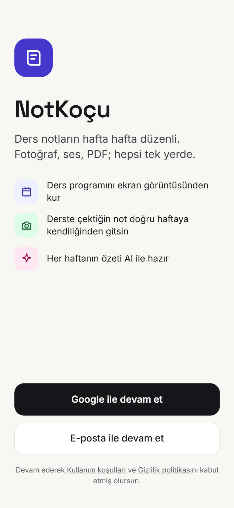
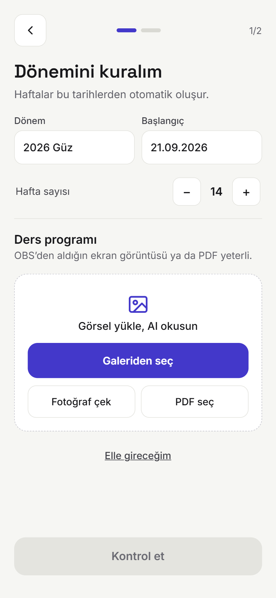
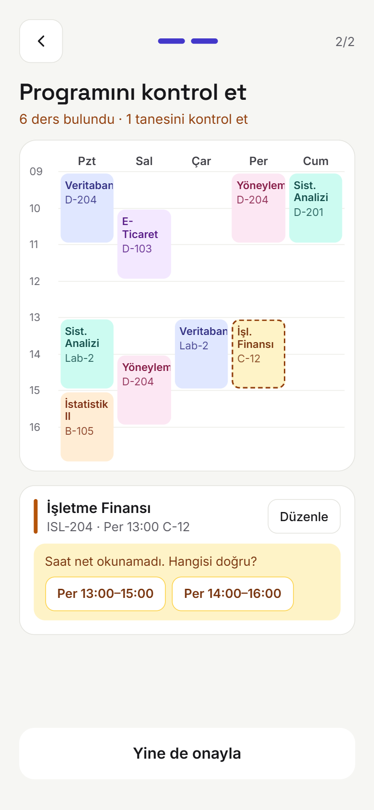
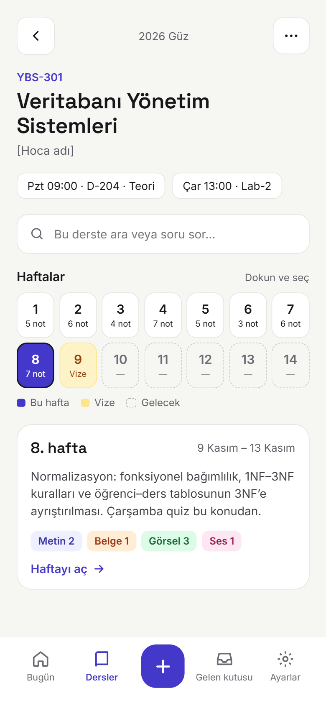
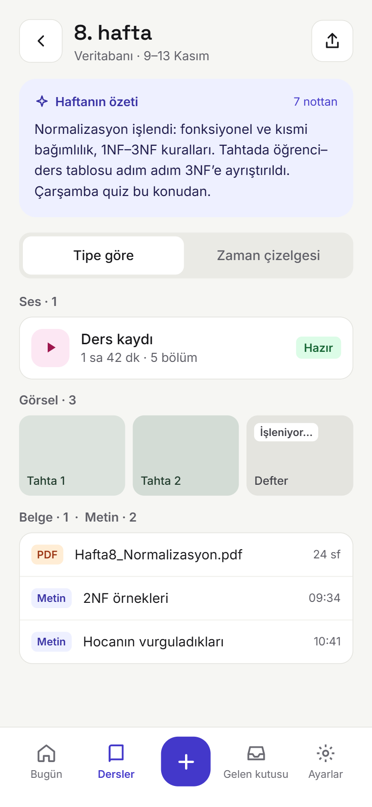
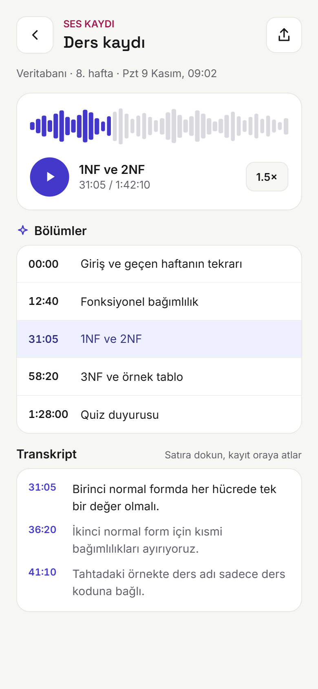
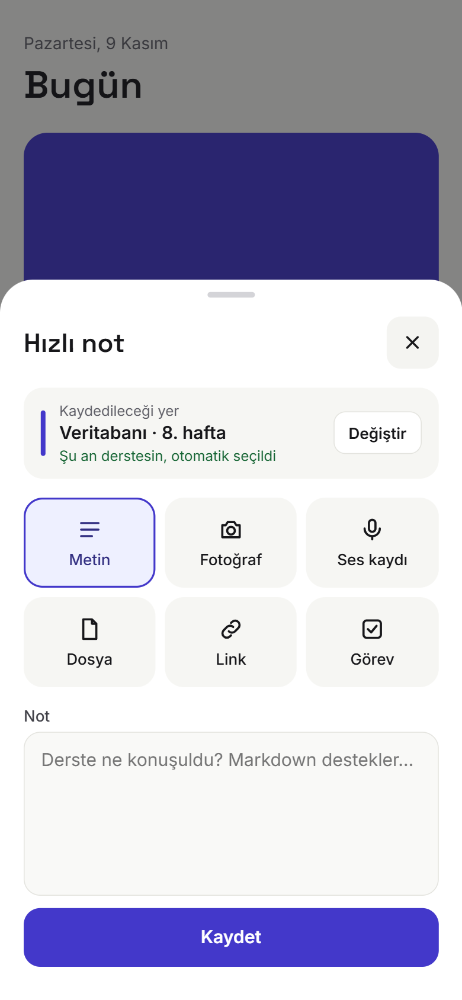
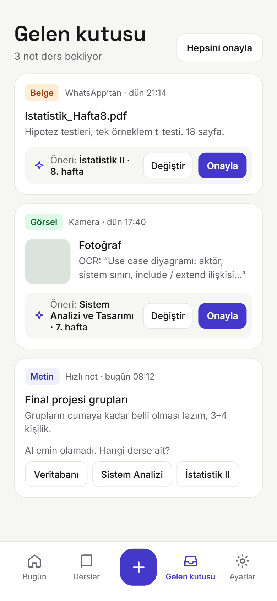

# NotKoçu

Üniversite öğrencileri için kişisel ders notu uygulaması. Notlar **dönem → ders → hafta** düzeninde tutulur; metin, belge, görsel, ses, link, görev ve kod notları AI (Gemini) ile metne çevrilir ve haftalık olarak özetlenir.

Yalnızca mobil (iOS + Android, Expo). Web sürümü ve grup/paylaşım sistemi yoktur; paylaşım için telefonun paylaşım menüsü kullanılır.

## Özellikler

- Ders programını ekran görüntüsünden otomatik kurma
- Ders saatinde alınan notu doğru ders ve haftaya otomatik atama
- 7 not tipi (metin, belge, görsel, ses, link, görev, kod) ve her biri için AI işleme: OCR, transkript, metin çıkarma
- Haftalık AI özeti
- Ders dışında alınan notlar için gelen kutusu ve AI ders önerisi
- Çevrimdışı not alma (outbox) ve Paylaş → NotKoçu entegrasyonu

## Tasarım mockup'ları (uygulama bunlardan farklılaşabilir)

| | | |
| :---: | :---: | :---: |
| <br>**Giriş** | <br>**Program yükle** | <br>**Program onayı** |
| <br>**Bugün** | <br>**Ders sayfası** | <br>**Hafta sayfası** |
| <br>**Not detayı** | <br>**Hızlı yakalama** | <br>**Gelen kutusu** |

## Uygulama ekran görüntüleri

Yakında. Gerçek ekran görüntüleri `docs/screenshots/` klasörüne eklenecek.

## Teknoloji yığını

| Katman | Seçim |
| --- | --- |
| Mobil | Expo (dev build), Expo Router, NativeWind, TanStack Query, TypeScript |
| API | Node.js + Express + Mongoose, TypeScript |
| Worker | MongoDB tabanlı kuyruk (OCR, transkript, özet) |
| Veritabanı ve dosyalar | MongoDB Atlas, dosyalar GridFS'te |
| AI | Gemini |
| Bildirim | Expo Push |

## Proje yapısı

```
apps/
  mobile/          Expo uygulaması
  api/             Express API
    src/worker/    Kuyruk işleyen worker
    src/services/ai/   Gemini çağrıları
packages/
  shared/          Mobil ve API arasında paylaşılan tipler
docs/
  teknik-plan.md   Kapsam, veri modeli, AI hattı, API, yol haritası
  ekranlar/        Ekran mockup'ları
  screenshots/     Gerçek uygulama ekran görüntüleri (yakında)
```

## Kurulum

### Gereksinimler

- Node.js ve npm (kök `package.json` npm workspaces kullanır: `apps/*`, `packages/*`)
- **MongoDB Atlas** kümesi (veriler ve GridFS dosyaları burada tutulur)
- **Gemini API anahtarı** ([Google AI Studio](https://aistudio.google.com/))
- **Google Cloud OAuth** istemcileri (Google ile giriş için):
  - **Web application** client: ID'si hem API'ye hem mobile verilir
  - **Android** client: yalnızca Google Cloud'da paket adı ve dev build'in **SHA-1** parmak iziyle tanımlanır; hiçbir `.env` dosyasına yazılmaz
- Android cihaz ve EAS hesabı (dev build için)

### Adımlar

1. Bağımlılıkları kur (kök dizinde): `npm install`
2. Ortam dosyalarını oluştur: `apps/api/.env.example` → `apps/api/.env`, `apps/mobile/.env.example` → `apps/mobile/.env`. Değerleri doldur (aşağıdaki tablo). `.env` dosyaları repoya girmez.
3. Mobil uygulamayı **dev build** olarak derle ve telefona kur:

   ```
   cd apps/mobile
   eas build --profile development --platform android
   ```

   Google ile giriş, paylaşım menüsü (`expo-share-intent`) ve push gibi native parçalar **Expo Go'da çalışmaz**; dev build gerekir.
4. Üç süreci ayrı terminallerde başlat:

   ```
   cd apps/api && npm run dev       # API
   cd apps/api && npm run worker    # Worker (OCR, transkript, özet)
   cd apps/mobile && npx expo start # Mobil (dev build'e bağlanır)
   ```

Telefon API'ye bilgisayarın yerel ağ IP'si üzerinden ulaşır (`EXPO_PUBLIC_API_URL`); API bu yüzden `0.0.0.0` üzerinde dinler.

### Ortam değişkenleri

**`apps/api/.env`**

| Değişken | Zorunlu | Açıklama |
| --- | :---: | --- |
| `NODE_ENV` | | `development` |
| `PORT` | | API portu (örnek: `4000`) |
| `HOST` | | `0.0.0.0`: aynı Wi-Fi'deki telefon erişebilsin |
| `MONGODB_URI` | ✔ | MongoDB Atlas bağlantı adresi |
| `JWT_ACCESS_SECRET` | ✔ | En az 32 karakterlik rastgele gizli anahtar |
| `GOOGLE_WEB_CLIENT_ID` | ✔ | OAuth Web application client ID; mobildeki ile aynı |
| `GEMINI_API_KEY` | ✔ | Gemini API anahtarı |
| `GEMINI_MODEL` | ✔ | Tüm işler için varsayılan model |
| `GEMINI_MODEL_OCR` | | Görsel OCR ve taranmış PDF modeli (boşsa `GEMINI_MODEL`) |
| `GEMINI_MODEL_SCHEDULE` | | Ders programı okuma modeli (boşsa `GEMINI_MODEL`) |
| `GEMINI_MODEL_AUDIO` | | Ses transkript modeli (boşsa `GEMINI_MODEL`) |
| `GEMINI_FALLBACK_MODEL` | | 500/503 alan istek bir kez bu modelle denenir |
| `GEMINI_THINKING_LEVEL` | | `MINIMAL` (varsayılan) ya da `LOW` |
| `AUDIO_MAX_PROCESS_MIN` | | Bundan uzun ses saklanır ama çevrilmez (örnek: `120`) |
| `AUDIO_DAILY_BUDGET_MIN` | | Kullanıcı başına günlük transkript dakikası (örnek: `180`) |
| `USER_STORAGE_LIMIT_MB` | | Kullanıcı başına dosya depolama sınırı (örnek: `200`) |

**`apps/mobile/.env`**

| Değişken | Zorunlu | Açıklama |
| --- | :---: | --- |
| `EXPO_PUBLIC_API_URL` | ✔ | API adresi, örn. `http://<bilgisayarın-yerel-ip>:4000` |
| `EXPO_PUBLIC_GOOGLE_WEB_CLIENT_ID` | ✔ | API'deki `GOOGLE_WEB_CLIENT_ID` ile aynı Web client ID |

### Komutlar

Kök dizin:

| Komut | Ne yapar |
| --- | --- |
| `npm test` | Vitest testlerini çalıştırır |
| `npm run typecheck` | Tüm workspace'lerde tip denetimi |

`apps/api`:

| Komut | Ne yapar |
| --- | --- |
| `npm run dev` | API'yi izleme modunda başlatır |
| `npm run worker` | Worker'ı izleme modunda başlatır |
| `npm run build` / `npm start` / `npm run start:worker` | Üretim derlemesi ve çalıştırma |
| `npm run check-docs` | Belge çıkarıcılarını çevrimdışı dener |
| `npm run check-queue` | Kuyruk ve öneri hattını dener (worker kapalıyken çalıştır) |
| `npm run check-http` | Uçtan uca HTTP akışını dener (worker kapalıyken çalıştır) |
| `npm run try-parse` | Ders programı okumayı dener |
| `npm run measure-import` | Dosyadan ses eklemede devam isteği sayısını ölçer |

`apps/mobile`:

| Komut | Ne yapar |
| --- | --- |
| `npx expo start` (ya da `npm start`) | Metro'yu başlatır |
| `npm run android` | Metro'yu başlatıp Android'de açar |
| `npm run typecheck` | Tip denetimi |

`check-queue` ve `check-http` varsayılan olarak sahte Gemini kullanır; gerçek istek yalnızca `CHECK_REAL_GEMINI=1` ile atılır.

## Dokümantasyon

Ayrıntılar için [docs/teknik-plan.md](docs/teknik-plan.md): kapsam, veri modeli, AI işleme hattı, API endpoint'leri ve MVP yol haritası.
